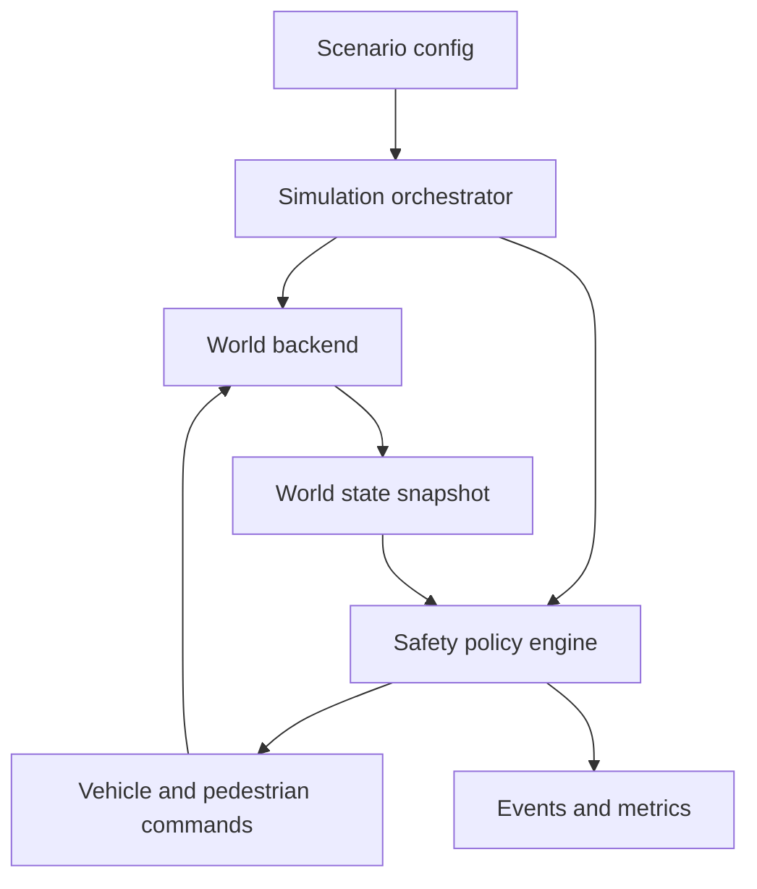

# Architecture

## Direction

The system separates simulation infrastructure from decision logic. The same policy engine should run against a deterministic test backend and a CARLA 3D backend.

## Core boundaries

### Scenario layer

Defines map, random seed, actor counts, spawn rules, weather, timing, and traffic policy parameters. Scenario configuration is data, not executable behavior.

### World backend

Provides an adapter around a simulation world. The first backend is a deterministic kinematic world used for tests. The CARLA backend will translate domain commands into CARLA actors and sensor subscriptions.

### Perception layer

Normalizes observations from ground truth, camera, LiDAR, radar, and future perception models into domain-level tracks. Initial safety experiments may use CARLA ground truth while keeping the boundary explicit.

### Safety policy engine

Owns the decisions that must be explainable:

- vehicle stopping and releasing;
- pedestrian crossing permission;
- conflict-zone reservation;
- emergency all-red behavior;
- minimum time-to-collision and clearance rules.

### Metrics and replay

Every policy decision emits a structured event with simulation time, actor IDs, reason codes, and relevant measurements. Scenario seeds and event streams make failures replayable.

## Safety invariants

The first invariants will be expressed as executable tests:

1. a vehicle may not enter a reserved crosswalk while a pedestrian occupies it;
2. pedestrians may not enter a crosswalk while a conflicting vehicle is inside the conflict zone;
3. a red-light command must be applied before the stop line is crossed;
4. emergency mode has priority over ordinary phase transitions;
5. a failed or stale observation fails safe for the affected conflict zone.

